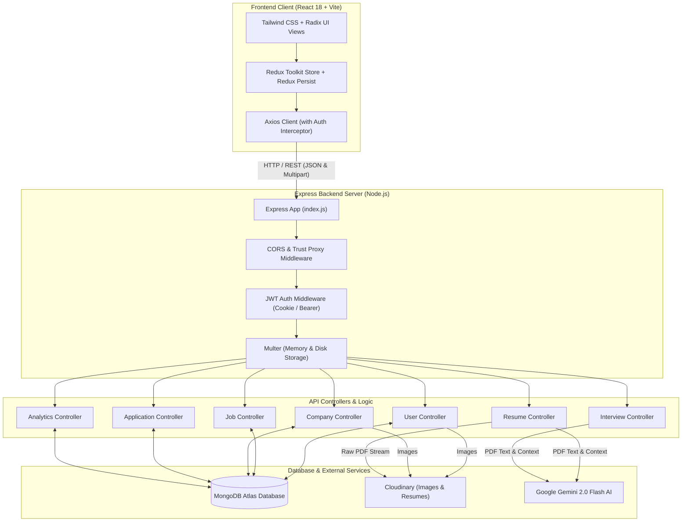
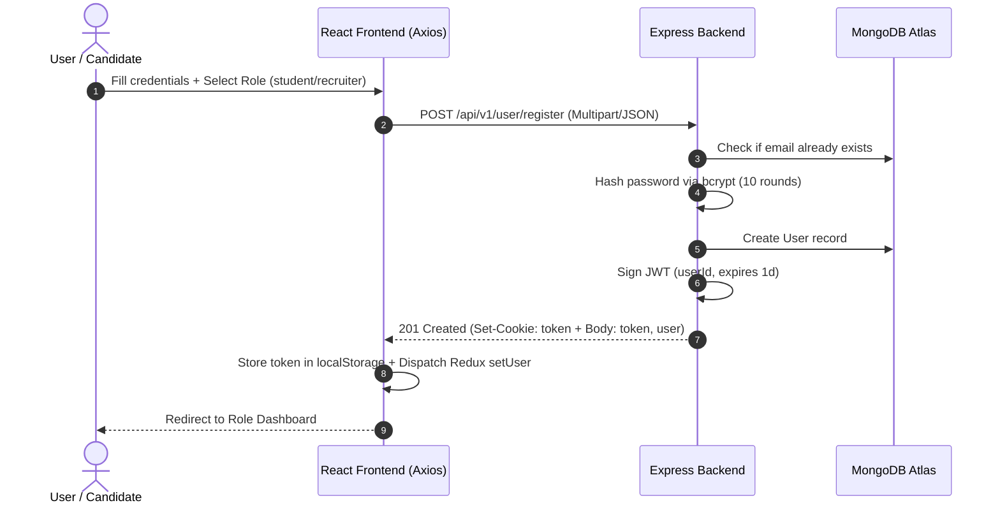
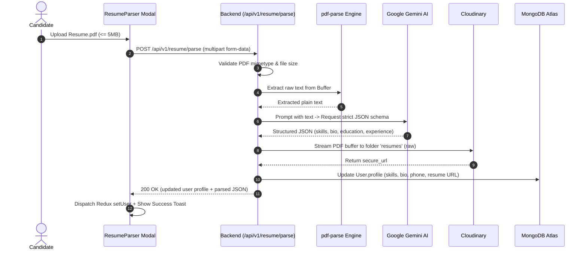

# NextHire

> **Full-Stack AI-Powered Job Portal & Recruitment Management System**

[](https://nodejs.org/)
[](https://expressjs.com/)
[](https://react.dev/)
[](https://vitejs.dev/)
[](https://www.mongodb.com/)
[](https://tailwindcss.com/)
[](https://ai.google.dev/)
[](https://cloudinary.com/)

---

## 1. Project Title & Tagline

**NextHire** is a modern, full-stack recruitment platform and career development ecosystem built on the MERN stack. It bridges the gap between job candidates and hiring teams by pairing real-time applicant tracking with Google Gemini Generative AI—automating PDF resume parsing and powering interactive, multi-stage mock technical interviews.

---

## 2. Overview

### What It Is
NextHire is a full-stack web application designed to handle the end-to-end recruitment lifecycle. Built as a decoupled client-server architecture with an Express/Node.js backend and a React 18/Vite frontend, NextHire provides dedicated portals for both job seekers (`student`) and employers (`recruiter`).

### Problem It Solves
- **High Application Friction:** Traditional platforms require candidates to repeatedly type skills, experience, and contact information into lengthy manual forms.
- **Unprepared Candidates:** Applicants rarely have access to customized, job-specific technical interview practice before speaking to a hiring manager.
- **Recruiter Overhead:** Hiring teams frequently sift through unstructured candidate pools without clear analytics on skill supply, acceptance ratios, or candidate pipelines.

### Why It Was Developed
NextHire was engineered to demonstrate how modern LLMs (Google Gemini 2.0 Flash) can be natively woven into recruitment workflows. Instead of treating AI as an external gimmick, NextHire integrates generative models directly into document ingestion (extracting schema-conforming user profiles from raw PDF byte streams) and candidate preparation (conducting role-specific, context-aware 5-stage simulated interviews).

### Target Audience
- **Job Candidates (`student`):** Candidates seeking curated software and tech opportunities, automated profile building via PDF resume upload, and targeted AI mock interview practice with instant feedback.
- **Hiring Managers & Recruiters (`recruiter`):** Employers needing to manage corporate profiles, post job vacancies, track candidate pipelines across review stages, and analyze talent demographics via rich graphical dashboards.

---

## 3. Key Features

- **🤖 Google Gemini Context-Aware Mock Interview Simulator:**
  An in-browser conversational interview simulator powered by `@google/generative-ai`. The engine ingests the specific job's title, description, and requirements alongside the applicant's bio and skills. It generates a warm opening question, conducts 5 progressive technical and behavioral interview rounds, evaluates candidate responses, and renders final actionable feedback accompanied by an authoritative performance score (`SCORE: X/10`).

- **📄 AI-Powered PDF Resume Parser & Direct Cloud Ingestion:**
  Candidates can upload raw PDF resumes (up to 5MB). The backend extracts text using `pdf-parse`, prompts Gemini to output a structured JSON schema (`fullname`, `phoneNumber`, `bio`, `skills`, `education`, `experience`), auto-updates the user's MongoDB profile, and streams the original PDF directly to Cloudinary raw cloud storage in a single transaction.

- **📊 Comprehensive Recruiter Analytics Dashboard:**
  An interactive metrics suite built with Recharts. Recruiters can monitor real-time recruitment KPIs including total job postings, aggregate applicant volume, review status distributions (`pending`, `accepted`, `rejected`), top 10 applicant skills frequency distributions, monthly application trend lines via `date-fns`, and top-performing job listings with calculated acceptance rates.

- **🔐 Dual-Layer Authentication & Cross-Domain Security:**
  Hybrid authentication architecture using JSON Web Tokens (JWT). The backend issues secure, `httpOnly`, conditional `sameSite: "None"` cookies while returning a bearer token fallback in the response body. An Axios request interceptor dynamically attaches bearer tokens from Redux/localStorage, ensuring smooth session persistence across cross-domain and mobile Safari environments.

- **🏢 Multi-Company & Job Lifecycle Management:**
  Recruiters can register multiple corporate entities with custom logos hosted on Cloudinary, draft and publish structured job listings (salary, experience level, requirements, vacancy count), and manage applicants in dedicated data tables.

- **🎯 Real-Time Job Discovery & Filtering:**
  Candidates can browse active jobs with backend search queries (MongoDB `$regex` matching on job titles and descriptions) and client-side multi-facet filters (role type, geographic location, and salary ranges).

- **📁 Unified Applicant Tracking System (ATS):**
  Candidates can apply to jobs with duplicate application protection. Recruiters can inspect applicants per posting, view Cloudinary-hosted resumes directly in the browser, and transition candidate status between `pending`, `accepted`, and `rejected`.

- **🎨 Enterprise Glassmorphism UI & Responsive Layout:**
  Crafted using Tailwind CSS v4, Radix UI primitives, Lucide React iconography, Framer Motion animations, and Redux Persist state management with persistent theme toggling.

---

## 4. Tech Stack

### Frontend Application
| Category | Technology | Version | Purpose in NextHire |
|---|---|---|---|
| **Core Framework** | React | `^18.3.1` | Component-based user interface rendering |
| **Build Tool** | Vite | `^6.0.5` | Fast HMR dev server and optimized production bundling |
| **Routing** | React Router DOM | `^7.2.0` | Client-side routing, protected routes, and navigation |
| **State Management** | Redux Toolkit | `^2.6.0` | Global state for auth, jobs, companies, and applications |
| **State Persistence** | Redux Persist | `^6.0.0` | LocalStorage session persistence across page refreshes |
| **Styling & Design** | Tailwind CSS | `^4.0.9` | Utility-first styling with `@tailwindcss/vite` |
| **UI Primitives** | Radix UI | Various | Accessible headless components (Dialog, Select, Popover, Avatar) |
| **Icons & Motion** | Lucide React / Framer Motion | `^0.476.0` / `^12.5.0` | Modern SVG iconography and micro-interactions |
| **Data Visualization**| Recharts | `^3.8.1` | Bar charts, line charts, and donut charts for recruiter analytics |
| **HTTP Client** | Axios | `^1.8.1` | API communication with custom request interceptor |
| **Feedback** | Sonner | `^2.0.1` | Rich toast notifications |

### Backend Application
| Category | Technology | Version | Purpose in NextHire |
|---|---|---|---|
| **Runtime** | Node.js (ESM) | `18+` | Server execution environment using native ES Modules |
| **Server Framework**| Express.js | `^4.21.2` | REST API routing, middleware chaining, and HTTP server |
| **Database ODM** | Mongoose | `^8.9.5` | Schema definition, validation, and MongoDB Atlas queries |
| **Authentication** | JSON Web Token | `^9.0.2` | Stateless cryptographic JWT token signing and verification |
| **Password Security**| bcryptjs | `^2.4.3` | Salted password hashing (10 salt rounds) |
| **AI Integration** | `@google/generative-ai` | `^0.24.1` | Google Gemini 2.0 Flash SDK for resume parsing & mock interview |
| **Document Parser** | `pdf-parse` | `^1.1.1` | In-memory text extraction from uploaded resume PDF buffers |
| **Cloud Storage** | Cloudinary SDK | `^2.0.1` | Cloud storage for profile photos, company logos, and raw PDF resumes |
| **File Ingestion** | Multer | `^1.4.5-lts.1` | Multi-part form-data handling (`diskStorage` & `memoryStorage`) |
| **Date Handling** | date-fns | `^4.1.0` | Date manipulation and monthly analytics grouping |
| **Cross-Origin** | CORS | `^2.8.5` | Cross-Origin Resource Sharing with dynamic origin validation |

### Database & Cloud Infrastructure
| Component | Platform / Service | Purpose |
|---|---|---|
| **Primary Database** | MongoDB Atlas | Managed NoSQL document store for Users, Jobs, Companies, Applications |
| **Cloud Media Storage** | Cloudinary | CDN-backed storage for images (logos, photos) and raw PDFs (resumes) |
| **AI Engine** | Google AI Studio (Gemini 2.0) | Contextual LLM inference for parsing and dynamic conversation |
| **Frontend Hosting** | Vercel | Production deployment with SPA routing rewrites (`vercel.json`) |
| **Backend Hosting** | Render / Node Web Service | Express server hosting with `trust proxy` enabled |

---

## 5. System Architecture

NextHire follows a decoupled, two-tier client-server architecture. The frontend React single-page application (SPA) communicates over HTTPS with the Express backend REST API. Persistent state is maintained in MongoDB Atlas, file assets are stored in Cloudinary, and AI capabilities are routed to Google Gemini.



### Architectural Component Responsibilities
- **Frontend Client (`Frontend/`):** Manages user session state, executes client-side filtering, handles local token persistence, and renders interactive analytics and chat interfaces.
- **Backend API Gateway (`Backend/index.js`):** Configures reverse proxy trust, enforces CORS against authorized origins, parses cookies and JSON bodies, and registers modular routes.
- **Middleware Pipeline (`Backend/middlewares/`):** Validates authentication tokens with dual cookie/bearer resolution, enforces upload file formats (PDFs and image extensions), and sets 5MB size caps.
- **AI Utility Layer (`Backend/utils/`):** Contains standalone Gemini integration modules (`resumeParser.js`, `interviewAI.js`) that isolate prompt engineering and structured JSON sanitization from controller logic.

---

## 6. How It Works

### Workflow 1: User Registration & Dual-Token Authentication



### Workflow 2: AI PDF Resume Parsing



### Workflow 3: AI Mock Interview Simulation

1. **Initialization (`POST /api/v1/interview/start`):** The candidate triggers an interview for a specific job. The backend fetches the job description, required skills, and candidate's profile, prompting Gemini to formulate a personalized, non-numbered opening question.
2. **Conversation Loop (`POST /api/v1/interview/message`):**
   - **Rounds 1 through 4:** The candidate submits their answer. Gemini reviews the response, provides 1–2 sentences of positive feedback, and issues the next technical, behavioral, or situational question.
   - **Round 5 (Final Evaluation):** Upon receiving the final answer, Gemini analyzes the complete conversation history, delivers a comprehensive review highlighting strengths and areas for improvement, and appends a standardized score: `SCORE: X/10`.
3. **Completion & UI State:** The frontend chatbot detects the `SCORE:` token, marks `isCompleted: true`, renders a celebratory trophy UI, and displays the final score badge.

---

## 7. Production Deployment
- **Live Frontend URL:** [https://next-hire-omega-ruby.vercel.app](https://next-hire-omega-ruby.vercel.app) 

---

## 8. Installation & Setup

Follow these verified steps to run NextHire locally on your machine.

### Prerequisites
- **Node.js:** v18.0.0 or higher
- **npm:** v9.0.0 or higher
- **MongoDB:** A running local MongoDB instance or a free MongoDB Atlas connection string
- **Cloudinary Account:** For image and PDF storage credentials
- **Google Gemini API Key:** From [Google AI Studio](https://aistudio.google.com/)

### Step 1: Clone the Repository
```bash
git clone https://github.com/saurabh0772/NextHire.git
cd NextHire
```

### Step 2: Configure Backend Services
```bash
cd Backend

# Install backend dependencies
npm install

# Create local environment configuration
cp .env.example .env
```
Open `Backend/.env` in your editor and provide your MongoDB URI, JWT secret, Cloudinary credentials, and Gemini API key.

Start the backend server in development mode:
```bash
npm run dev
```
*The backend API will initialize on `http://localhost:8000` with nodemon auto-reload.*

### Step 3: Configure Frontend Application
Open a new terminal window:
```bash
cd Frontend

# Install frontend dependencies
npm install

# Create local environment configuration
cp .env.example .env
```
Verify that `Frontend/.env` points to the local backend:
```env
VITE_API_URL=http://localhost:8000
```

Start the Vite development server:
```bash
npm run dev
```
*The frontend client will start on `http://localhost:5173`.*

### Step 4: Production Build Verification
To build and preview the optimized frontend production bundle:
```bash
cd Frontend
npm run build
npm run preview
```
To run the production backend service:
```bash
cd Backend
npm start
```

---

## 9. Environment Variables

All sensitive credentials and connection strings are managed strictly through environment variables. Safe reference templates are available at [`Backend/.env.example`](file:///home/saurabh/Documents/PROJECTS/next-hire/Backend/.env.example) and [`Frontend/.env.example`](file:///home/saurabh/Documents/PROJECTS/next-hire/Frontend/.env.example).

### Backend Variables (`Backend/.env`)

| Variable | Description | Required | Safe Placeholder / Example |
|---|---|:---:|---|
| `PORT` | Local port for Express HTTP server | Optional | `8000` (Defaults to `8000` if omitted) |
| `NODE_ENV` | Application runtime environment | Optional | `development` or `production` |
| `FRONTEND_URL` | Frontend origin for CORS and cookie policy | Required | `http://localhost:5173` |
| `MONGO_URI` | MongoDB Atlas or local connection string | Required | `mongodb+srv://<user>:<password>@cluster0.mongodb.net/nexthire` |
| `SECRET_KEY` | Secret key used to sign and verify JWT tokens | Required | `your_super_secret_jwt_key_here` |
| `CLOUDINARY_CLOUD_NAME` | Cloudinary account cloud name | Required | `your_cloud_name` |
| `CLOUDINARY_API_KEY` | Cloudinary account public API key | Required | `123456789012345` |
| `CLOUDINARY_API_SECRET` | Cloudinary account private API secret | Required | `your_cloudinary_api_secret` |
| `GEMINI_API_KEY` | Google Gemini API key from AI Studio | Required | `AIzaSy...your_gemini_api_key` |

### Frontend Variables (`Frontend/.env`)

| Variable | Description | Required | Safe Placeholder / Example |
|---|---|:---:|---|
| `VITE_API_URL` | Base HTTP endpoint of the backend API | Required | `http://localhost:8000` |

---

## 10. API Documentation

All backend API routes are prefixed under `/api/v1`.

### Authentication & User Module (`/api/v1/user`)

| Method | Endpoint | Description | Auth Required | Parameters / Body |
|---|---|---|:---:|---|
| `POST` | `/register` | Register new user account with optional photo/resume | No | **Multipart Body:** `fullname`, `email`, `phoneNumber`, `password`, `role` (`student`\|`recruiter`), `profilePhoto` *(file)* |
| `POST` | `/login` | Authenticate user credentials and return JWT | No | **JSON Body:** `email`, `password`, `role` |
| `GET` | `/me` | Fetch profile details of logged-in user | **Yes** | None (Resolves user from JWT) |
| `PUT` | `/update-profile` | Update user details, profile picture, or resume | **Yes** | **Multipart Body:** `fullname`, `email`, `phoneNumber`, `bio`, `skills`, `profilePhoto`, `resume` |
| `GET` | `/logout` | Expire JWT session and clear authentication cookie | No | None |

### Company Module (`/api/v1/company`)

| Method | Endpoint | Description | Auth Required | Parameters / Body |
|---|---|---|:---:|---|
| `POST` | `/register` | Register a new corporate entity | **Yes** (Recruiter) | **JSON Body:** `companyName` |
| `GET` | `/get` | Fetch all companies created by logged-in recruiter | **Yes** (Recruiter) | None |
| `GET` | `/get/:id` | Fetch specific company details by ID | **Yes** | **URL Param:** `id` (Company ObjectId) |
| `PUT` | `/update/:id` | Update company information and upload logo | **Yes** (Recruiter) | **Multipart Body:** `name`, `description`, `website`, `location`, `file` *(logo image)* |
| `GET` | `/past-recruiters` | Retrieve list of companies with active job postings | No | None |

### Job Module (`/api/v1/job`)

| Method | Endpoint | Description | Auth Required | Parameters / Body |
|---|---|---|:---:|---|
| `POST` | `/post` | Create a new job listing | **Yes** (Recruiter) | **JSON Body:** `title`, `description`, `requirements` *(comma-separated)*, `salary`, `location`, `jobType`, `experience`, `position`, `companyId` |
| `GET` | `/get` | Fetch all jobs (supports search filtering) | No | **Query Param:** `keyword` *(optional title/description search)* |
| `GET` | `/get/:id` | Fetch single job with populated application list | **Yes** | **URL Param:** `id` (Job ObjectId) |
| `GET` | `/getadminjobs` | Fetch all jobs posted by the authenticated recruiter | **Yes** (Recruiter) | None |

### Application Module (`/api/v1/application`)

| Method | Endpoint | Description | Auth Required | Parameters / Body |
|---|---|---|:---:|---|
| `GET` | `/apply/:id` | Submit an application for a specific job | **Yes** (Student) | **URL Param:** `id` (Job ObjectId) |
| `GET` | `/get` | Fetch all jobs applied to by the logged-in student | **Yes** (Student) | None |
| `GET` | `/:id/applicants` | Retrieve all applicants for a specific job | **Yes** (Recruiter) | **URL Param:** `id` (Job ObjectId) |
| `POST` | `/status/:id/update`| Update candidate status (`pending`, `accepted`, `rejected`) | **Yes** (Recruiter) | **URL Param:** `id` (Application ObjectId)<br>**JSON Body:** `status` |
| `GET` | `/recruiter/all` | Fetch all applications across all jobs | **Yes** (Recruiter) | None |

### AI Resume Module (`/api/v1/resume`)

| Method | Endpoint | Description | Auth Required | Parameters / Body |
|---|---|---|:---:|---|
| `POST` | `/parse` | Extract resume details via Gemini and upload PDF | **Yes** (Student) | **Multipart Body:** `resume` *(PDF file, max 5MB)* |

**Example Response (`POST /api/v1/resume/parse`):**
```json
{
  "success": true,
  "message": "Resume parsed and profile updated successfully",
  "parsedData": {
    "fullname": "Alex Johnson",
    "email": "alex@example.com",
    "phoneNumber": "9876543210",
    "bio": "Full-stack developer with 3 years experience building scalable MERN web applications.",
    "skills": ["React", "Node.js", "Express", "MongoDB", "TypeScript", "Tailwind CSS"],
    "education": [
      { "degree": "B.Tech Computer Science", "institution": "State University", "year": "2024" }
    ],
    "experience": [
      { "title": "Software Engineer Intern", "company": "TechCorp", "duration": "6 months", "description": "Built REST APIs" }
    ]
  },
  "user": {
    "_id": "6724...",
    "fullname": "Alex Johnson",
    "email": "alex@example.com",
    "role": "student",
    "profile": {
      "bio": "Full-stack developer...",
      "skills": ["React", "Node.js", "Express", "MongoDB"],
      "resume": "https://res.cloudinary.com/.../resumes/raw/upload/resume.pdf"
    }
  }
}
```

### AI Interview Simulation Module (`/api/v1/interview`)

| Method | Endpoint | Description | Auth Required | Parameters / Body |
|---|---|---|:---:|---|
| `POST` | `/start` | Generate the opening question for a role | **Yes** (Student) | **JSON Body:** `jobId` |
| `POST` | `/message` | Submit candidate answer and get feedback / next question | **Yes** (Student) | **JSON Body:** `jobId`, `userAnswer`, `conversationHistory`, `questionNumber` |

### Recruiter Analytics Module (`/api/v1/analytics`)

| Method | Endpoint | Description | Auth Required | Parameters / Body |
|---|---|---|:---:|---|
| `GET` | `/recruiter` | Retrieve computed KPIs, charts data, and skill trends | **Yes** (Recruiter) | None |

---

## 11. Project Structure

```text
NextHire/
├── .gitignore                      # Root ignore rules for node_modules, env files, uploads
├── README.md                       # Comprehensive project documentation
│
├── Backend/                        # Node.js + Express REST API Server
│   ├── controllers/                # Business logic and request handlers
│   │   ├── analyticsController.js  # Recruiter metrics and trend computations
│   │   ├── application.controller.js# Job applications and ATS status updates
│   │   ├── company.controller.js   # Company registration, branding, and lookup
│   │   ├── interviewController.js  # Gemini AI mock interview orchestrator
│   │   ├── job.controller.js       # Job posting, queries, and recruiter job listings
│   │   ├── resumeController.js     # PDF ingestion and Cloudinary raw upload handler
│   │   └── user.controller.js      # User registration, login, profile updates, and JWT
│   ├── middlewares/                # Request processing and validation middleware
│   │   ├── isAuthenticated.js      # Dual-token (cookie / Authorization header) verification
│   │   ├── multer.js               # Disk storage multer instance with fileFilter validation
│   │   ├── multer.middleware.js    # Additional multer storage utilities
│   │   └── upload.js               # Multer destination configuration
│   ├── models/                     # Mongoose document schemas
│   │   ├── application.model.js    # Application schema (Job ref, Applicant ref, status)
│   │   ├── company.model.js        # Company schema (name, description, logo, user ref)
│   │   ├── job.model.js            # Job schema (title, salary, requirements, applications)
│   │   └── user.model.js           # User schema (roles, profile, skills, hashed password)
│   ├── routes/                     # Express router definitions
│   │   ├── analyticsRoute.js       # Route: /api/v1/analytics
│   │   ├── application.route.js    # Route: /api/v1/application
│   │   ├── company.route.js        # Route: /api/v1/company
│   │   ├── interviewRoute.js       # Route: /api/v1/interview
│   │   ├── job.route.js            # Route: /api/v1/job
│   │   ├── resumeRoute.js          # Route: /api/v1/resume
│   │   ├── user.route.js           # Route: /api/v1/user
│   │   └── user.routes.js          # Legacy user route definitions
│   ├── uploads/                    # Local temporary folder for multer uploads
│   │   └── .gitkeep                # Directory anchor (actual media is ignored by git)
│   ├── utils/                      # Helper libraries and external service wrappers
│   │   ├── cloudinary.js           # Cloudinary SDK configuration and file uploader
│   │   ├── db.js                   # Mongoose connection logic to MongoDB Atlas
│   │   ├── interviewAI.js          # Google Gemini AI prompts for mock interview
│   │   └── resumeParser.js         # pdf-parse + Gemini schema prompt for resume extraction
│   ├── .env.example                # Safe environment variable template for backend
│   ├── index.js                    # Server entry point, CORS configuration, route binding
│   ├── package.json                # Backend dependencies and scripts
│   └── test_signed_url.js          # Standalone test script for Cloudinary signed URLs
│
└── Frontend/                       # React 18 + Vite Single Page Application
    ├── public/                     # Static browser assets
    │   ├── favicon.svg             # NextHire application favicon
    │   └── vite.svg                # Vite logo asset
    ├── src/
    │   ├── assets/                 # SVGs and brand images
    │   ├── components/             # Reusable and page-level React components
    │   │   ├── admin/              # Recruiter management views (Jobs, Companies, Applicants)
    │   │   ├── auth/               # Authentication views (Login.jsx, Signup.jsx)
    │   │   ├── recruiter/          # Recruiter dashboard and analytics views
    │   │   ├── shared/             # Global components (Navbar, Footer, InterviewChatbot, ResumeParser)
    │   │   ├── ui/                 # Headless styled UI primitives (Dialog, Button, Input, Table)
    │   │   ├── Browse.jsx          # Public job search and filter gallery
    │   │   ├── HeroSection.jsx     # Landing page hero banner and search input
    │   │   ├── Home.jsx            # Landing page aggregator
    │   │   ├── Job.jsx             # Individual job card component
    │   │   ├── JobDescription.jsx  # Detailed job specification and apply button
    │   │   ├── Jobs.jsx            # Job discovery list with filter sidebar
    │   │   ├── LatestJobs.jsx      # Home page latest postings carousel
    │   │   └── Profile.jsx         # Candidate profile management and applied jobs table
    │   ├── hooks/                  # Custom React data-fetching hooks
    │   │   ├── useGetAllAdminJobs.jsx
    │   │   ├── useGetAllCompanies.jsx
    │   │   ├── useGetAllJobs.jsx
    │   │   ├── useGetAppliedJobs.jsx
    │   │   ├── useGetCompanyById.jsx
    │   │   └── useGetRecruiterJobs.jsx
    │   ├── redux/                  # Redux Toolkit store and feature slices
    │   │   ├── applicationSlice.js # Applications state slice
    │   │   ├── authSlice.js        # User auth, token, and profile state slice
    │   │   ├── companySlice.js     # Company listings state slice
    │   │   ├── jobSlice.js         # Jobs, single job, and filter query state slice
    │   │   └── store.js            # Store configuration with Redux Persist middleware
    │   ├── utils/                  # Client-side constants and network helpers
    │   │   ├── axiosInstance.js    # Axios client with Authorization header interceptor
    │   │   └── constant.js         # API endpoint base constants
    │   ├── App.css                 # Base application CSS overrides
    │   ├── App.jsx                 # Client router setup and session restoration
    │   ├── index.css               # Global Tailwind CSS definitions and themes
    │   └── main.jsx                # Application DOM mounting and Redux Provider wrapper
    ├── .env.example                # Safe environment variable template for frontend
    ├── .gitignore                  # Frontend ignore rules
    ├── eslint.config.js            # ESLint 9 configuration
    ├── index.html                  # HTML5 document template
    ├── package.json                # Frontend dependencies and scripts
    ├── vercel.json                 # Vercel deployment SPA rewrite rule
    └── vite.config.js              # Vite bundler configuration with Tailwind plugin
```

---

## 12. Testing

### Current Testing Status
- **Automated Test Suites:** Neither the backend nor the frontend currently includes automated unit or end-to-end test suites (e.g., Jest, Vitest, Cypress, or Supertest).
- **Backend Test Script:** Running `npm test` in the `Backend/` directory executes:
  ```bash
  echo "Error: no test specified" && exit 1
  ```
- **Manual Verification Script:** The repository includes [`Backend/test_signed_url.js`](file:///home/saurabh/Documents/PROJECTS/next-hire/Backend/test_signed_url.js), a manual Node.js utility script used to verify Cloudinary raw signed URL generation and fetch response codes for PDF assets.
- **Frontend Linting:** Code quality and formatting can be checked using ESLint:
  ```bash
  cd Frontend
  npm run lint
  ```

---

## 13. Security Considerations

The codebase implements several real, verifiable security controls:

- **Salted Password Hashing:** User passwords are never stored in plain text. Passwords are encrypted using `bcryptjs` with 10 salt rounds prior to document creation.
- **Stateless JWT with Expiration:** Tokens are signed using a server-side `SECRET_KEY` with a strict `1d` expiration window.
- **Cross-Domain Cookie Hardening:** Authentication cookies are configured with `httpOnly: true` (preventing client-side JavaScript access via XSS) and dynamically set `sameSite: "None"` and `secure: true` when running in production or on Vercel deployments.
- **Dual Authentication Fallback:** The backend `isAuthenticated` middleware inspects `req.cookies.token` first, but gracefully falls back to `req.headers.authorization` (`Bearer <token>`). This prevents authorization loss on browsers with third-party cookie restrictions (e.g., Safari ITP).
- **Role-Based Access Control (RBAC):** Users are assigned explicit roles (`student` or `recruiter`). Frontend routes are wrapped in `<ProtectedRoute />`, preventing unauthorized candidates from accessing recruiter dashboards.
- **File Validation & Size Quotas:** Multer upload handlers enforce strict mimetype and regex file extension filters (`.jpg`, `.png`, `.pdf`) and reject files exceeding 5MB to defend against storage exhaustion.
- **Safe CORS Origin Policies:** The backend rejects cross-origin requests unless the origin is explicitly included in the `allowedOrigins` allowlist or the server is running in `development` mode.
- **Reverse Proxy Protection:** `app.set('trust proxy', 1)` is enabled in `Backend/index.js` to ensure secure cookie transport across Render and Vercel reverse proxy load balancers.
- **Sanitized Git History:** All `.env` secrets, node module binaries, and personal uploaded documents have been purged from Git history using `git-filter-repo`.

---

## 14. Future Improvements

The following improvements reflect architectural gaps and potential enhancements identified from code analysis:

- **Automated Testing Suite:** Introduce Vitest and React Testing Library for frontend component testing, and Supertest with an in-memory MongoDB server (`mongodb-memory-server`) for backend integration tests.
- **API Rate Limiting:** Implement `express-rate-limit` on `/api/v1/user/login`, `/api/v1/resume/parse`, and `/api/v1/interview/message` to prevent abuse and protect Gemini API quota limits.
- **Field Consistency in Applications Query:** Harmonize the application filtering query in [`Backend/controllers/application.controller.js`](file:///home/saurabh/Documents/PROJECTS/next-hire/Backend/controllers/application.controller.js#L141) where `match: { recruiter: recruiterId }` is queried, whereas [`Backend/models/job.model.js`](file:///home/saurabh/Documents/PROJECTS/next-hire/Backend/models/job.model.js#L40) defines the field as `created_by`.
- **Server-Side Pagination:** Replace unpaginated `Job.find()` and `Application.find()` queries with cursor-based or limit/skip pagination to optimize performance with large databases.
- **Email Notifications:** Integrate transactional email delivery (e.g., Resend or Nodemailer) to alert candidates when recruiters update their application status (`accepted`/`rejected`).

---

## 15. Author

- **Author:** Saurabh Kumar
- **GitHub:** [@saurabh0772](https://github.com/saurabh0772)
- **Repository:** [https://github.com/saurabh0772/NextHire.git](https://github.com/saurabh0772/NextHire.git)
